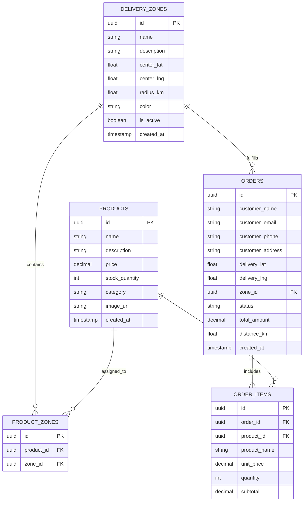

# AdProMax Delivery OS 🚚

> **Mobile-First Geospatial Delivery Management & Order Dispatch Platform**  
> Engineered with Next.js 16 (App Router), TypeScript, Leaflet OpenStreetMap, Supabase PostgreSQL, and a tailored Webflow-inspired design system.

---

## 📌 Executive Summary

**AdProMax Delivery OS** is an end-to-end delivery operations and fleet dispatch system designed from the ground up for mobile and desktop screens. It solves the last-mile verification challenge by coupling **interactive geospatial geofencing** with **real-time point-in-zone mathematical boundary validation**.

Orders placed outside authorized delivery zones are proactively rejected with precise distance diagnostics, while orders within valid service zones dynamically filter inventory to items available in that specific sector.

---

## 🏗️ System Architecture & Design

### High-Level Architecture Diagram

```
┌────────────────────────────────────────────────────────────────────────┐
│                        CLIENT LAYER (Mobile & Desktop)                 │
│                                                                        │
│   Mobile Bottom Navigation   │   Webflow Design System Components      │
│   Interactive Leaflet Map    │   Nominatim Geocoding & GPS Radar       │
└───────────────────────────────────┬────────────────────────────────────┘
                                    │ HTTPS / REST / WebSockets
                                    ▼
┌────────────────────────────────────────────────────────────────────────┐
│                        NEXT.JS 16 APP ROUTER (Server / Edge)           │
│                                                                        │
│  ┌───────────────────────┐  ┌───────────────────────┐  ┌─────────────┐ │
│  │ Geospatial Engine     │  │ Order Lifecycle       │  │ Auth Guard  │ │
│  │ (Haversine Formula)   │  │ (Inventory Sync)      │  │ (SSR/Token) │ │
│  └───────────────────────┘  └───────────────────────┘  └─────────────┘ │
└───────────────────────────────────┬────────────────────────────────────┘
                                    │ PostgREST / RLS Policies
                                    ▼
┌────────────────────────────────────────────────────────────────────────┐
│                      SUPABASE POSTGRESQL & AUTH                        │
│                                                                        │
│   • delivery_zones        • products              • product_zones      │
│   • orders                • order_items           • auth.users         │
└────────────────────────────────────────────────────────────────────────┘
```

---

## 🧮 Geospatial Verification Engine

Every customer location picked on the map undergoes spherical distance verification using the **Haversine formula**:

$$\Delta\sigma = 2 \arcsin\left(\sqrt{\sin^2\left(\frac{\Delta\phi}{2}\right) + \cos(\phi_1)\cos(\phi_2)\sin^2\left(\frac{\Delta\lambda}{2}\right)}\right)$$

$$d = R \cdot \Delta\sigma \quad (\text{where } R = 6371\text{ km})$$

1. **Inside Zone**: If $d \le r_{\text{zone}}$, the order is approved, assigned to the corresponding zone ID, and displays distance to hub.
2. **Outside All Zones**: If $d > r_{\text{zone}}$ across all active zones, the order submission is strictly blocked, identifying the closest zone and the exact distance outside the boundary (e.g. `1.42 km outside "Downtown Express"`).

---

## 📊 Database Schema & Entity Relationships



---

## ⚡ Technology Stack

| Layer | Technology | Purpose |
|---|---|---|
| **Framework** | Next.js 16 (App Router, Turbopack) | Server components, client interactivity, and optimized builds |
| **Language** | TypeScript (Strict mode) | Type safety across geospatial models, DB entities, and UI state |
| **Styling** | Tailwind CSS v4 & Vanilla CSS | Webflow-inspired design tokens, 4px tight radius, responsive layout |
| **Maps & GIS** | Leaflet & OpenStreetMap | Open-source interactive map, dynamic circle geofences, custom pins |
| **Geocoding** | Nominatim OpenStreetMap API | Reverse and forward address search without proprietary API keys |
| **Backend & DB** | Supabase (PostgreSQL 15) | Relational database, foreign key constraints, Row-Level Security |
| **Authentication**| Supabase Auth (`@supabase/ssr`) | Secure session handling, email/password, demo user provider |
| **Icons & FX** | Lucide React & Canvas Confetti | Visual iconography and feedback micro-animations |

---

## 🎨 Webflow-Inspired Design Language

The UI strictly adheres to the design specification defined in [`design.md`](./design.md):

- **Primary Conversion Color**: Deep near-black `#080808` reserved for primary CTAs, typography titles, and wordmarks.
- **5-Stop Chromatic Accent Palette**:
  - `Purple` (`#7a3dff`): Flagship core zones & primary metric highlights
  - `Blue` (`#3b89ff`): Logistics geofences & information pills
  - `Green` (`#00d722`): Delivered status badges & eco zones
  - `Orange` (`#ff6b00`): Out for delivery indicators & commercial zones
  - `Pink` (`#ed52cb`): Category cards & notifications
- **Tight Geometry**: Clean 4px (`rounded-sm`) borders for buttons, badges, and text inputs; 8px (`rounded-md`) for card containers. Zero pill buttons.
- **Mobile-First Experience**:
  - Bottom navigation bar with quick tabs (Dashboard, Map, Zones, Products, Orders, Profile).
  - Bottom sheet drawers with mobile drag handle and sticky confirmation footers.
  - Safe-area inset support (`pb-safe`) for seamless iOS/Android browsing.

---

## 🚀 Key Features

### 1. User Authentication
- Operator Sign In, Sign Up, and Sign Out.
- **1-Click Demo Login** with pre-configured operator test credentials.
- Protected session provider syncing client and Supabase state.

### 2. Product Management
- Create, edit, and delete products (title, price, stock quantity, category, and image URL).
- **Multi-Zone Assignment**: Link products to specific delivery zones or all zones via relational join table.
- Automatic inventory depletion upon confirmed customer checkout.

### 3. Delivery Zone Management
- Open-source Leaflet interactive map with custom tile rendering.
- Visual circular geofences with center pin coordinates and adjustable radius slider (0.5 km to 20 km).
- Operational toggle (Active / Paused) and custom chromatic color assignment.

### 4. Order Dispatch with Point-in-Zone Verification
- Interactive map pin selection or address search with automatic reverse geocoding.
- Instant mathematical point-in-zone evaluation via the Haversine formula.
- **Rejection Protection**: Blocks order creation if customer is outside all active zones with exact distance diagnostics.
- Zone-filtered product selection (only products allocated to that location's zone are orderable).

### 5. Delivery Operations Dashboard
- Executive KPI metrics: Total Revenue, Active Deliveries, Operational Zones, Low Stock Alerts.
- Zone performance breakdown: order count, revenue, and product catalog depth per zone.
- Real-time orders stream with status update controls (`Pending` $\rightarrow$ `Confirmed` $\rightarrow$ `Out for Delivery` $\rightarrow$ `Delivered`).

---

## 🛠️ Local Development & Setup

### Prerequisites
- Node.js 18+ (tested on Node v24)
- npm, yarn, or pnpm
- A free [Supabase](https://supabase.com) project

### 1. Clone & Install
```bash
git clone git@github.com:KhalfaouiDriss/AdProMax-challenge.git
cd AdProMax-challenge
npm install
```

### 2. Environment Configuration
Create a `.env.local` file in the root directory:
```env
NEXT_PUBLIC_SUPABASE_URL=https://your-project.supabase.co
NEXT_PUBLIC_SUPABASE_ANON_KEY=your-anon-or-publishable-key
NEXT_PUBLIC_SUPABASE_PUBLISHABLE_KEY=your-anon-or-publishable-key
```

### 3. Database Migration
Open your project in the [Supabase Dashboard](https://supabase.com/dashboard), navigate to the **SQL Editor**, and execute the script found in:
```
supabase/schema.sql
```
This script creates all 5 tables (`delivery_zones`, `products`, `product_zones`, `orders`, `order_items`) along with foreign keys, cascading rules, and Row Level Security (RLS) policies.

### 4. Run the Development Server
```bash
npm run dev
```
Open [http://localhost:3000](http://localhost:3000) in your browser.

---

## 🔑 Test Credentials

For evaluation and testing, you can use the built-in demo credentials or click **"1-Click Sign In"** on the login modal:

| Field | Value |
|---|---|
| **Email** | `demo@adpromax.delivery` |
| **Password** | `Demo123456!` |
| **Role** | Dispatch Lead / Operator |

---

## 🤖 AI Tools & Workflow

This project was architected, engineered, and polished using an agentic AI pair programming workflow:

- **Gemini Flash (Antigravity AI Agent)**:
  - **System Architecture & Design**: Scaffolding the Next.js 16 App Router application, TypeScript geospatial data models, and database relations.
  - **Interactive Requirements Alignment (`/grill-me`)**: Walking down each branch of the product design tree to specify role models, map interactions, and deployment flows.
  - **Geospatial Engine**: Synthesis of the zero-dependency Haversine great-circle boundary validation engine with dynamic radius checking and nearest-zone diagnostics.
  - **Webflow Design Language**: Translating the design specifications from `design.md` into a responsive, mobile-first design system with custom tokens and tight 4px geometry.
  - **Autonomous Browser Verification**: Headless browser automation (`browser_subagent`) to validate map rendering, mobile drawers, and responsive viewports.

- **OpenCode & Nemotron 3 Ultra**:
  - **Micro-Tasks & Routines**: Executing focused subroutines, targeted refactors, string utilities, and fine-grained code cleanup across helper scripts.

---

## 📄 License
MIT License &copy; 2026 AdProMax Engineering. All rights reserved.
